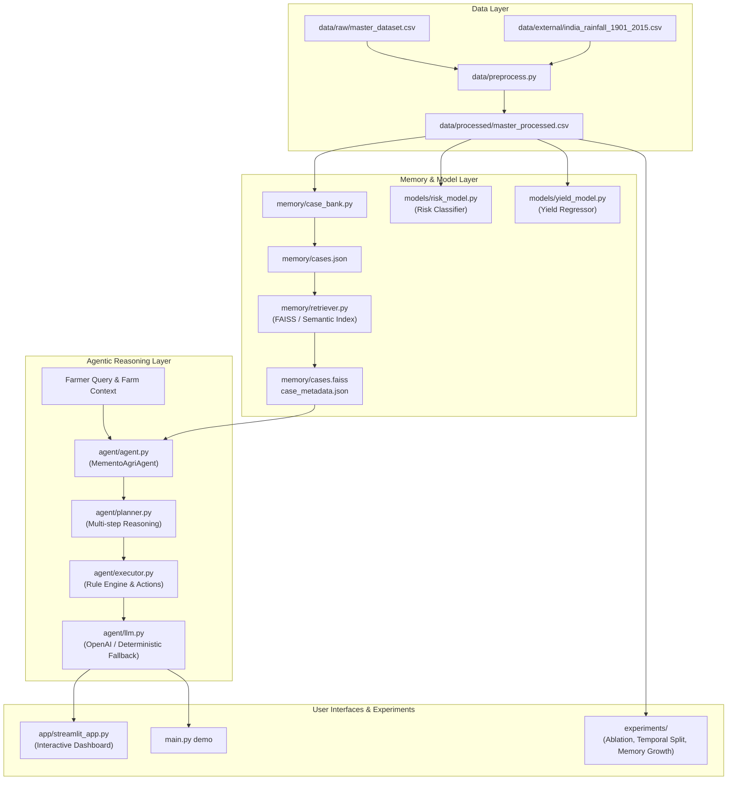

# Memento-Agri

**Outcome-Aware Memory-Augmented LLM Agent for Personalized Climate-Resilient Agricultural Advisory.**

Memento-Agri uses historical crop-climate observations and resilience outcomes as an external, frozen-weight memory layer. When a farmer asks for guidance under adverse climate conditions, the system retrieves similar historical cases, applies outcome-aware reranking (favoring resilient yield outcomes), and synthesizes a localized, actionable advisory using an agentic Planner-Executor architecture.

---

## 🏛️ System Architecture & Workflow



---

## 📁 Repository Directory Structure

```text
Memento-Agri/
├── agent/                       # Reasoning & Advisory Agent
│   ├── agent.py                 # MementoAgriAgent coordinating retriever, planner, and executor
│   ├── executor.py              # Executes advisory plan and selects candidate interventions
│   ├── interventions.py         # Transparent, evidence-based agronomic rule engine
│   ├── llm.py                   # LLM integration (OpenAI API or local deterministic engine)
│   └── planner.py               # Formulates structured multi-step advisory plan
│
├── app/                         # Interactive User Interface
│   └── streamlit_app.py         # Full-featured Streamlit farmer advisory dashboard
│
├── data/                        # Datasets & Ingestion
│   ├── external/                # Official external reference series (IMD Rainfall 1901–2015)
│   ├── processed/               # Cleaned tabular datasets with climate stress & anomalies
│   ├── raw/                     # Master raw dataset (master_dataset.csv)
│   ├── preprocess.py            # Feature engineering (anomalies, stress indices, risk scores)
│   ├── real_climate.py          # Merges genuine IMD historical weather observations
│   └── sample_master_dataset.csv# Small sample dataset for quick sanity checks
│
├── memory/                      # Outcome-Aware Case Memory
│   ├── case_bank.py             # Converts tabular rows into structured case objects
│   └── retriever.py             # CaseRetriever: Dual FAISS & Scikit-learn vector search with outcome reranking
│
├── models/                      # Machine Learning Baselines
│   ├── risk_model.py            # RandomForest climate risk classifier (Low, Moderate, High, Severe)
│   └── yield_model.py           # HistGradientBoosting crop yield regressor
│
├── evaluation/                  # Metrics & Benchmarks
│   ├── baselines.py             # Baseline evaluation functions (similarity-only, LLM-only)
│   └── metrics.py               # Scoring utilities (Precision@K, advisory term coverage)
│
├── experiments/                 # Reproducible Research Protocols
│   ├── run_ablation.py          # Ablation study: Baseline vs. Memory-Augmented retrieval
│   ├── run_memory_growth.py     # Evaluates performance scaling with memory size
│   └── run_temporal_split.py    # Strict temporal train/validation/test evaluation split
│
├── outputs/                     # Experiment output logs, metrics JSONs, and split files
├── config.py                    # Central configuration (paths, aliases, hyper-parameters)
├── main.py                      # Unified CLI entry point for the entire pipeline
├── requirements.txt             # Project dependencies
└── RESEARCH_PROTOCOL.md         # Research methodology and scientific guidelines
```

---

## ⚡ Quick Start

### 1. Environment Setup

```bash
python -m venv .venv
source .venv/bin/activate        # Windows: .venv\Scripts\activate
pip install -r requirements.txt
```

### 2. End-to-End Execution Pipeline

Run the commands in order using `main.py`:

```bash
# 1. Preprocess raw data and engineer climate stress features
python main.py build

# 2. Train baseline climate-risk classifier
python main.py train-risk

# 3. Train baseline crop-yield regressor
python main.py train-yield

# 4. Build case bank and construct semantic memory index
python main.py build-memory

# 5. Run deterministic CLI advisory demo
python main.py demo

# 6. Launch the interactive Streamlit dashboard
streamlit run app/streamlit_app.py
```

### 3. Optional LLM Integration

The agent runs fully deterministically offline without any API key. If you wish to use OpenAI LLM generation:

```bash
export OPENAI_API_KEY="sk-..."
export OPENAI_MODEL="gpt-4.1-mini"
python main.py demo
```

*(On Windows PowerShell, use `$env:OPENAI_API_KEY="sk-..."`)*

---

## 🔬 Research Experiments

To reproduce the experiments described in `RESEARCH_PROTOCOL.md`:

```bash
python experiments/run_ablation.py
python experiments/run_memory_growth.py
python experiments/run_temporal_split.py
```

Outputs are automatically saved to `outputs/`:
- `outputs/ablation_results.json`
- `outputs/memory_growth_results.json`
- `outputs/temporal_split.csv`
- `outputs/temporal_split_metadata.json`

---

## 💡 Key Architectural Principles

1. **Weight-Free Continual Adaptation:** The core LLM parameters remain frozen; domain adaptation occurs entirely through dynamic case memory.
2. **Outcome-Aware Reranking:** Memory retrieval does not solely prioritize syntactic/climate similarity—it up-ranks cases where positive yield resilience was achieved under comparable stress.
3. **No Fabricated Interventions:** Candidate recommendations come from verified transparent agronomic rule layers rather than hallucinated historical causality.
4. **Cross-Platform Resilience:** `CaseRetriever` automatically uses FAISS + SentenceTransformers when available, and smoothly falls back to Scikit-Learn TF-IDF vector cosine indexing if C++ binaries or Torch wheels are absent.

---

## ⚠️ Disclaimer

This is an academic research prototype. Recommendations generated by this system must be validated by qualified agricultural extension specialists and official government agrometeorological advisories before real-world farm deployment.
